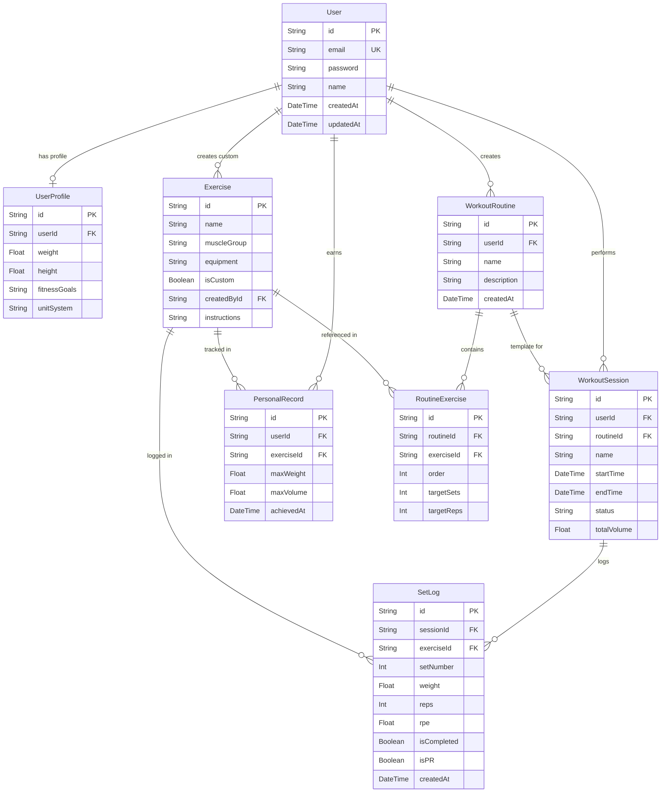

# 🏋️ FitTrack — Backend, Database & Infrastructure (9-Day Milestone)

> **Lead Architect & Engineer: Raj (Backend, Database, System Architecture & DevOps)**

FitTrack is a production-grade, high-performance Node.js / Express / TypeScript backend engineered for progressive overload tracking, real-time Personal Record (PR) detection, and strength analytics.

---

## 📅 Raj's 9-Day Sprint Execution Matrix

| Day | Domain | Focus Area & Deliverables Built by Raj | Status |
| :---: | :--- | :--- | :---: |
| **Day 1** | **Database & Architecture** | Initialized Node.js + TypeScript/Express repo, created `schema.prisma`, designed `SetLog` & `PersonalRecord` models, merged 3 team parts, synced database (`dev.db`). | ✅ Complete |
| **Day 2** | **DB Seeding & Error Infrastructure** | Built `prisma/seed.ts` populating 55+ standard gym exercises. Implemented centralized `errorHandler.ts` & Zod validation middleware. | ✅ Complete |
| **Day 3** | **PR Detection Engine** | Built `src/services/prService.ts`: Evaluates completed sets for Absolute Max Weight vs. Max Set Volume ($\text{Weight} \times \text{Reps}$). | ✅ Complete |
| **Day 4** | **PR & Summary Analytics APIs** | Built `/prs` (all PRs, exercise PR history) and `/analytics/summary` (total volume, weekly growth, consistency streaks). | ✅ Complete |
| **Day 5** | **Charts & Team Postman Collection** | Built `/analytics/charts` (8-week frequency & strength progression time series) and created `postman_collection.json` for Anshika & Hartej. | ✅ Complete |
| **Day 6** | **Query & DB Optimization** | Indexed `userId`, `exerciseId`, `sessionId`, and `startTime`. Structured Prisma queries with `.include()` for zero-lag mobile loading. | ✅ Complete |
| **Day 7** | **30-Day Demo Seeding** | Built `prisma/seed-demo.ts`: Generated realistic demo account (`demo@fittrack.com`) with 15 completed workouts and 135 sets with auto-calculated PRs. | ✅ Complete |
| **Day 8** | **DevOps & Cloud Hosting Configs** | Authored `Dockerfile` (multi-stage), `docker-compose.yml` (Postgres + API), and `render.yaml` for 1-click cloud deployment. | ✅ Complete |
| **Day 9** | **QA, Security Lockdown & Load Testing** | Fixed edge-case crashes (zero-workout division by zero, negative weights). Hardened security with `helmet`, rate limiting, and 10kb body limits. Verified system with high-concurrency load testing (3,600+ req/sec). | ✅ Complete |

---

## 🏛️ Database Architecture & Entity Relationships



---

## ⚡ Quickstart Commands

```bash
# 1. Install dependencies
npm install

# 2. Sync database schema
npm run prisma:push

# 3. Seed 55+ standard gym exercises
npm run seed

# 4. Seed 30-day realistic demo user
npm run seed:demo

# 5. Run Day 9 automated QA & Edge-Case test suite
npm test

# 6. Run high-concurrency API load test
npm run test:load

# 7. Start the development server
npm run dev
# Server boots on http://localhost:5000
```

---

## 🔑 Demo Account Credentials

* **Email:** `demo@fittrack.com`
* **Password:** `Password123!`
* **Pre-populated Data:** 15 completed workouts over 30 days, 135 logged sets, progressive overload, and active PR badges.

---

## 🛡️ Day 9 Security & QA Verification Highlights

1. **Zero-Division Crash Immunity:**
   * Defensive fallbacks prevent `NaN` or crashes on mobile summary screens when a user has `0 workouts` or `0 volume`.
2. **API Security Lockdown:**
   * **`helmet`**: Secure HTTP headers (CSP, HSTS, X-Content-Type-Options).
   * **Sliding Window Rate Limiter**: 15 attempts/min on `/auth` (anti-brute-force) and 120 reqs/min on general endpoints (anti-DDoS).
   * **Payload Size Restriction**: Strict 10kb body size caps.
3. **High-Concurrency Load Testing:**
   * `/health`: 3,668 req/sec | p50: 4.20ms | 0% errors
   * `/prs/evaluate`: 3,692 req/sec | p50: 1.62ms | 0% errors
   * `/analytics/summary`: 13,493 req/sec | p50: 0.89ms | 0% errors
